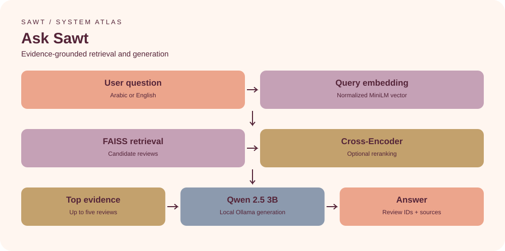

<div align="center">


# Sawt | صوت

**A bilingual NLP workspace for understanding customer feedback.**

[Overview](#overview) · [Architecture](#architecture) · [AI pipeline](#ai-pipeline) · [Run locally](#run-locally) · [Limitations](#limitations)

</div>

## Overview

Sawt transforms customer reviews into searchable, interpretable insights. Explore sentiment, discover semantic topics, inspect named entities and ask questions grounded in actual review evidence. The application supports Arabic and English, with a local-first inference workflow.

| Workspace | Purpose |
|---|---|
| Semantic Universe | Interactive PCA projection of review embeddings, grouped by topic |
| Explore | Review browsing, filtering, semantic retrieval and sentiment inference |
| Ask Sawt | Retrieval-augmented answers with supporting review IDs |
| AI Labs | Evaluation and experiment outputs from the NLP pipeline |
| Settings | Artifact availability and system health |

## Architecture


The offline notebooks prepare data and export artifacts. FastAPI serves those artifacts and runs inference; React, TypeScript and Vite provide the interactive interface. Ollama runs the local generative model. The application does not require retraining at startup.

## AI pipeline


| Lab | Focus |
|---|---|
| 01 | Multilingual tokenization and Arabic normalization |
| 02 | Transformer anatomy and attention concepts |
| 03 | Sentiment classification and named entity recognition |
| 04 | Language and script analysis |
| 05 | Embeddings, semantic retrieval and reranking |
| 06 | Evaluation, error analysis and reliability |

### Model inventory

| Task | Model / method |
|---|---|
| Sentiment baseline | Character TF-IDF + logistic regression |
| Sentiment transformer | `distilbert-base-multilingual-cased`, fine-tuned |
| NER | `Davlan/xlm-roberta-base-ner-hrl` |
| Embeddings | `sentence-transformers/paraphrase-multilingual-MiniLM-L12-v2` |
| Topics | K-means; PCA for visualization |
| Retrieval | FAISS inner-product search over normalized embeddings |
| Reranking | `cross-encoder/mmarco-mMiniLMv2-L12-H384-v1` |
| Generation | `qwen2.5:3b` via Ollama |

Sentiment inference uses the model recorded in `models/selected_model.json`. Topic names are descriptive, not supervised ground truth. The application reads available evaluation CSVs rather than hard-coding performance claims.

## Retrieval-augmented generation



The query is cleaned and embedded, FAISS retrieves candidates, and optional reranking refines relevance. Up to five retrieved reviews are passed to the local LLM. Answers should cite review IDs and acknowledge insufficient evidence. Retrieved text is treated as untrusted data.

## Project layout

```text
sawt/
├── backend/main.py
├── frontend/
│   ├── package.json
│   └── src/
├── data/processed/
│   ├── masked.csv
│   ├── clusters.csv
│   ├── cluster_labels.csv
│   ├── embeddings.npy
│   ├── feedback.faiss
│   ├── entities.csv
│   └── sentiment_metrics.csv
├── models/
│   ├── sentiment.joblib
│   ├── distilbert/
│   └── selected_model.json
├── docs/
└── README.md
```

Other notebook exports and cached models may also be present. Keep the matching index, vectors and review rows together.

## Run locally

### Fresh installation (macOS / Linux)

Install [Python 3.12](https://www.python.org/downloads/), [Node.js 22](https://nodejs.org/), and [Ollama](https://ollama.com/download). Start Ollama before setup. Clone your repository, enter its root, and run:

```bash
bash setup.sh
```

For a first-time clone, restore the original project's **entire matching `data/processed/` and `models/` directories** from a trusted private transfer. These are intentionally excluded from Git. No retraining is required when they are available. Do not mix exports from different notebook runs. Review data and serialized joblib models must come from trusted sources; do not publish them without permission.

```bash
bash start.sh
```

Open [Sawt Studio](http://127.0.0.1:5173) or [API documentation](http://127.0.0.1:8000/docs). First semantic search may download Hugging Face models. For offline use, pre-cache both models and set `SAWT_ALLOW_DOWNLOAD=0`.

### Optional LLM switch

```bash
ollama pull llama3.1:8b
SAWT_LLM=llama3.1:8b bash start.sh
```

Default is Qwen 2.5 3B, the previously working model. Llama is optional and not yet evaluated on this dataset; Arabic is not officially supported by Llama 3.1. Existing cached topic names remain unchanged until regenerated.

### Publish safely

```bash
git init
git add .
git status --short
git commit -m "Initial Sawt Studio release"
git branch -M main
git remote add origin YOUR_GITHUB_REPOSITORY_URL
git push -u origin main
```

Create an empty GitHub repository first. Inspect staged files and notebook source for secrets and private paths before committing. The repository is a local application, not a hosted deployment. Share artifacts separately through an approved private channel. For exact dependency reproduction, capture `python -m pip freeze` from the working Mac and review platform-specific dependencies; the supplied requirements pin the Hugging Face compatibility group only. Notebooks are included without outputs for reproducibility, not required for startup. Their original training paths may need adjustment.

### Smoke tests

```bash
curl http://127.0.0.1:8000/api/health
curl 'http://127.0.0.1:8000/api/reviews?q=&offset=0&limit=15'
curl -X POST http://127.0.0.1:8000/api/search -H 'Content-Type: application/json' -d '{"text":"جودة المنتج","rerank":true}'
curl -X POST http://127.0.0.1:8000/api/chat -H 'Content-Type: application/json' -d '{"text":"ما هي أبرز شكاوى العملاء؟","rerank":true}'
```

Stop services with Ctrl+C. Preserve the environment and saved artifacts; no notebook rerun is required for normal restart. Thread limits are retained from the successful local troubleshooting session; the original native crash root cause was not confirmed.

## API reference

| Method | Endpoint | Purpose |
|---|---|---|
| GET | `/api/health` | File availability |
| GET | `/api/overview` | Corpus summary |
| GET | `/api/universe` | PCA points and topics |
| GET | `/api/reviews` | Paginated review search |
| GET | `/api/entities` | Entity summaries |
| GET | `/api/metrics` | Available evaluation exports |
| POST | `/api/analyze` | Sentiment inference |
| POST | `/api/search` | Semantic search |
| POST | `/api/chat` | Evidence-grounded answers |
| POST | `/api/topic-names` | Generate descriptive topic names |

## Limitations

- Binary sentiment does not capture neutral or mixed opinions explicitly.
- Topic clusters are exploratory; PCA is a lossy projection and cluster labels are not verified categories.
- Retrieval and NER may cover subsets rather than the entire corpus. NER confidence is not measured accuracy.
- Regex masking is not a guarantee of anonymization. Review data should be checked before publication.
- RAG answers can be incomplete or incorrect; inspect the evidence and avoid corpus-wide claims based on a few retrieved reviews.
- Local development configuration is not a hardened production deployment. Do not publish private data, secrets or model artifacts without reviewing rights and privacy.

## References

[FastAPI](https://fastapi.tiangolo.com/) · [React](https://react.dev/) · [Vite](https://vite.dev/) · [Sentence Transformers](https://www.sbert.net/) · [FAISS](https://github.com/facebookresearch/faiss) · [Hugging Face Transformers](https://huggingface.co/docs/transformers/) · [Ollama](https://docs.ollama.com/) · [Qwen 2.5](https://ollama.com/library/qwen2.5)

---

<div align="center">Sawt · لكل صوت حكاية</div>
