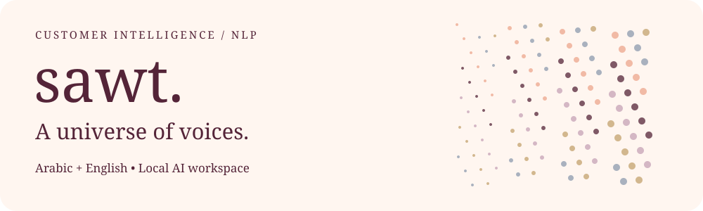

<div align="center">



# Sawt | صوت

**A bilingual NLP workspace for understanding customer feedback.**


[Overview](#overview) · [Architecture](#architecture) · [AI Pipeline](#ai-pipeline) · [Run Locally](#run-locally) · [Limitations](#limitations)

</div>

---

## Overview

Sawt transforms customer reviews into searchable, interpretable insights. Explore sentiment, discover semantic topics, inspect named entities, and ask questions grounded in actual review evidence.

The application supports Arabic and English, with a local-first inference workflow that combines traditional machine learning, multilingual transformers, semantic retrieval, and generative AI.

| Workspace | Purpose |
|---|---|
| Semantic Universe | Interactive PCA projection of review embeddings, grouped by topic |
| Explore | Review browsing, filtering, semantic retrieval, and sentiment inference |
| Ask Sawt | Retrieval-augmented answers with supporting review IDs |
| AI Labs | Evaluation and experiment outputs from the NLP pipeline |
| Settings | Artifact availability and system health |

---

## Architecture

<div align="center">

</div>

The offline notebooks prepare data and export artifacts. FastAPI serves those artifacts and runs inference, while React, TypeScript, and Vite provide the interactive interface.

Ollama runs the local generative model. The application does not require retraining at startup when the necessary artifacts are available.

| Layer | Technology |
|---|---|
| Frontend | React, TypeScript, Vite |
| Visualization | D3.js, Recharts |
| Backend | Python, FastAPI |
| Machine Learning | Scikit-learn |
| Deep Learning | PyTorch, Hugging Face Transformers |
| Semantic Retrieval | Sentence Transformers, FAISS |
| Generative AI | Ollama |
| Data Processing | Pandas, NumPy |

---

## AI Pipeline

<div align="center">

</div>

### Notebook Structure

The project is organized into two main notebooks, covering the end-to-end workflow from raw customer reviews to evidence-grounded AI responses.

#### Notebook 01 — Preprocessing and NLP Pipeline

This notebook prepares the dataset, develops the NLP components, evaluates their performance, and exports the artifacts required by the application.

| Stage | Description |
|---|---|
| Exploratory Data Analysis | Analyze dataset characteristics, sentiment distribution, and review lengths |
| Data Cleaning | Remove invalid records, duplicates, and inconsistent entries |
| Arabic Normalization | Normalize Arabic characters, whitespace, and diacritics |
| PII Masking | Mask identifiable patterns such as email addresses and phone numbers |
| Multilingual Tokenization | Analyze tokenization behavior across Arabic and English |
| Sentiment Classification | Train and evaluate traditional ML and transformer-based classifiers |
| Named Entity Recognition | Extract named entities from customer reviews |
| Language and Script Analysis | Examine multilingual and mixed-script content |
| Semantic Embeddings | Generate multilingual review representations |
| Topic Discovery | Apply K-means clustering to discover semantic groups |
| Dimensionality Reduction | Use PCA to visualize review embeddings |
| Semantic Retrieval | Build a FAISS index for similarity-based search |
| Reranking | Refine retrieved results using a multilingual cross-encoder |
| Evaluation | Assess model performance and analyze limitations |
| Artifact Export | Save processed data, trained models, embeddings, and evaluation results |

#### Notebook 02 — Retrieval-Augmented Generation

This notebook builds on the artifacts generated by the NLP pipeline to support evidence-grounded question answering.

| Stage | Description |
|---|---|
| Artifact Loading | Load processed reviews, embeddings, and the FAISS index |
| Query Processing | Normalize and encode user questions |
| Evidence Retrieval | Retrieve semantically relevant customer reviews |
| Reranking | Refine candidate relevance |
| Context Construction | Prepare retrieved evidence for the language model |
| Answer Generation | Generate responses using a local LLM through Ollama |
| Evidence Attribution | Associate answers with supporting review IDs |
| Evaluation | Inspect retrieval relevance, grounding, and answer quality |

The notebooks are intended for experimentation and reproducibility. They are not required during normal application startup when the exported artifacts are available.

### Model Inventory

| Task | Model / Method |
|---|---|
| Sentiment baseline | Character TF-IDF + Logistic Regression |
| Sentiment transformer | `distilbert-base-multilingual-cased`, fine-tuned |
| Named entity recognition | `Davlan/xlm-roberta-base-ner-hrl` |
| Semantic embeddings | `sentence-transformers/paraphrase-multilingual-MiniLM-L12-v2` |
| Topic discovery | K-means clustering |
| Visualization | Principal Component Analysis (PCA) |
| Semantic retrieval | FAISS inner-product search over normalized embeddings |
| Reranking | `cross-encoder/mmarco-mMiniLMv2-L12-H384-v1` |
| Answer generation | `qwen2.5:3b` via Ollama |

Sentiment inference uses the model recorded in `models/selected_model.json`.

Topic names are descriptive rather than supervised ground truth. The application reads available evaluation CSV files instead of hard-coding performance claims.

---

## Retrieval-Augmented Generation

<div align="center">

</div>

Sawt uses Retrieval-Augmented Generation (RAG) to answer questions using actual customer feedback rather than relying exclusively on the language model's internal knowledge.

The query is cleaned and embedded, FAISS retrieves relevant candidates, and optional reranking refines their relevance.

Up to five retrieved reviews are passed to the local language model. Answers should cite supporting review IDs and acknowledge insufficient evidence.

Retrieved review text is treated as untrusted data.

---

## Project Layout

```text
Applied_NLP_SDAIA/
│
├── backend/
│   ├── main.py
│   └── requirements.txt
│
├── frontend/
│   ├── package.json
│   └── src/
│
├── notebooks/
│   ├── Preprocessing and NLP notebook
│   └── RAG notebook
│
├── data/
│   └── processed/
│       ├── masked.csv
│       ├── clusters.csv
│       ├── cluster_labels.csv
│       ├── embeddings.npy
│       ├── feedback.faiss
│       ├── entities.csv
│       └── sentiment_metrics.csv
│
├── models/
│   ├── sentiment.joblib
│   ├── distilbert/
│   └── selected_model.json
│
├── docs/
│   ├── banner.svg
│   ├── architecture.svg
│   ├── nlp.svg
│   └── rag.svg
│
├── setup.sh
├── start.sh
├── .gitignore
└── README.md
```

The notebook names above describe their purpose. Additional evaluation exports, index-mapping files, and cached models may also be present.

Keep the matching index, embeddings, and review rows together.

---

## Run Locally

Follow the instructions below to download, configure, and run Sawt on your own machine.

No model retraining or notebook execution is required when the precomputed artifacts are available.

### 1. Prerequisites

Install the following tools before running the application.

| Requirement | Recommended Version | Download |
|---|---|---|
| Python | 3.12 | [Python](https://www.python.org/downloads/) |
| Node.js | 22 | [Node.js](https://nodejs.org/) |
| Git | Latest stable | [Git](https://git-scm.com/downloads) |
| Ollama | Latest stable | [Ollama](https://ollama.com/download) |

**Recommended system configuration:**

- macOS or Linux
- 16 GB RAM or more
- Sufficient storage for pretrained models and processed artifacts
- Internet connection during initial installation

A dedicated GPU is not required. Local inference performance depends on available hardware.

### 2. Download the Project

Clone the GitHub repository:

```bash
git clone https://github.com/romey101/Applied_NLP_SDAIA.git
cd Applied_NLP_SDAIA
```

Alternatively, download the project directly:

[Download Sawt as ZIP](https://github.com/romey101/Applied_NLP_SDAIA/archive/refs/heads/main.zip)

Extract the ZIP file and open a terminal inside the extracted project directory.

### 3. Prepare the Data and Model Artifacts

Sawt uses precomputed NLP artifacts and trained models to avoid repeating expensive preprocessing and training operations.

The application requires the complete matching contents of:

```text
data/processed/
models/
```

If these directories already contain the required artifacts, proceed to the next step.

Otherwise, check the repository's Releases page:

[GitHub Releases](https://github.com/romey101/Applied_NLP_SDAIA/releases)

If an artifact package is available, download it and extract its contents into the project root.

If no artifact package is available, contact the repository maintainer to obtain the required files through an approved transfer method.

The source code alone is not sufficient to run every feature of the application.

Do not mix artifacts generated from different notebook executions. Only load serialized model files from trusted sources.

### 4. Start Ollama

Open a terminal and start the Ollama service:

```bash
ollama serve
```

If Ollama is already running, continue to the next step.

Open another terminal and download the default language model:

```bash
ollama pull qwen2.5:3b
```

Verify that the model is available:

```bash
ollama list
```

### 5. Install Dependencies

Navigate to the project root and run:

```bash
bash setup.sh
```

The setup script prepares the Python virtual environment and installs the required backend and frontend dependencies.

This step is only required during the initial installation or when project dependencies change.

### 6. Launch Sawt

From the project root, run:

```bash
bash start.sh
```

Once the services have started, open the application in your browser.

| Service | URL |
|---|---|
| Sawt Studio | [http://127.0.0.1:5173](http://127.0.0.1:5173) |
| Backend API | [http://127.0.0.1:8000](http://127.0.0.1:8000) |
| API Documentation | [http://127.0.0.1:8000/docs](http://127.0.0.1:8000/docs) |
| System Health | [http://127.0.0.1:8000/api/health](http://127.0.0.1:8000/api/health) |

The first semantic search may require downloading pretrained Hugging Face models.

For offline operation, the required models must already be cached locally.

---

### Manual Startup

If the automated scripts are unavailable or fail, start the application using three separate terminals.

#### Terminal 1 — Ollama

```bash
ollama serve
```

Skip this command if Ollama is already running.

#### Terminal 2 — Backend

Navigate to the project root.

Create and activate the Python virtual environment:

```bash
python3.12 -m venv .venv
source .venv/bin/activate
```

Install backend dependencies:

```bash
python -m pip install --upgrade pip
python -m pip install -r backend/requirements.txt
```

Configure the project environment:

```bash
export SAWT_ROOT="$(pwd)"
export PYTHONFAULTHANDLER=1
export OMP_NUM_THREADS=1
export MKL_NUM_THREADS=1
export OPENBLAS_NUM_THREADS=1
export VECLIB_MAXIMUM_THREADS=1
export TOKENIZERS_PARALLELISM=false
```

Start the FastAPI server:

```bash
cd backend

python -X faulthandler -m uvicorn main:app \
    --host 127.0.0.1 \
    --port 8000 \
    --workers 1 \
    --log-level debug
```

Thread limits are used to reduce native-library concurrency during local inference.

#### Terminal 3 — Frontend

Navigate to the project root, then run:

```bash
cd frontend
npm install
npm run dev
```

Open:

[http://127.0.0.1:5173](http://127.0.0.1:5173)

---

### Optional LLM Configuration

Sawt supports local language models through Ollama.

| Model | Ollama Identifier |
|---|---|
| Qwen 2.5 | `qwen2.5:3b` |
| Llama 3.1 | `llama3.1:8b` |
| Gemma 3 | `gemma3:4b` |
| Aya Expanse | `aya-expanse:8b` |

The default model is Qwen 2.5 3B.

To use Llama instead:

```bash
ollama pull llama3.1:8b
SAWT_LLM=llama3.1:8b bash start.sh
```

To use Gemma:

```bash
ollama pull gemma3:4b
SAWT_LLM=gemma3:4b bash start.sh
```

These commands require the backend version that supports the `SAWT_LLM` environment variable.

Alternative models may require additional memory and have not been fully evaluated on the Sawt dataset. Arabic generation quality may vary between models.

Changing the generative model does not require retraining the sentiment classifier, regenerating embeddings, or rebuilding the FAISS index.

Existing cached topic names remain unchanged until regenerated.

---

### Verify the Installation

Once the backend is running, use the following commands to verify the main application services.

#### System Health

```bash
curl http://127.0.0.1:8000/api/health
```

#### Review Retrieval

```bash
curl "http://127.0.0.1:8000/api/reviews?q=&offset=0&limit=15"
```

#### Semantic Search

```bash
curl -X POST http://127.0.0.1:8000/api/search \
    -H "Content-Type: application/json" \
    -d '{"text":"جودة المنتج","rerank":true}'
```

#### Retrieval-Augmented Generation

```bash
curl -X POST http://127.0.0.1:8000/api/chat \
    -H "Content-Type: application/json" \
    -d '{"text":"ما هي أبرز شكاوى العملاء؟","rerank":true}'
```

A successful health response confirms artifact availability. The search and chat tests verify that inference services are functioning.

---

### Troubleshooting

| Issue | Recommended Solution |
|---|---|
| Missing artifact | Verify the contents of `data/processed/` and `models/` |
| Ollama connection error | Confirm Ollama is running on port 11434 |
| Language model not found | Download the selected model using `ollama pull` |
| Python dependency conflict | Use Python 3.12 and the supplied requirements file |
| Segmentation fault | Apply thread limits, avoid mixing Conda and virtual environments, and investigate CPU-only inference |
| Frontend dependency error | Run `npm install` inside `frontend/` |
| Backend connection error | Confirm FastAPI is running on port 8000 |
| Slow first request | Allow time for model downloading and initialization |
| Port already in use | Stop the existing service using the same port |

Native inference crashes may require additional platform-specific troubleshooting. Thread limits are a mitigation rather than a guaranteed fix.

### Stop and Restart

Press `Ctrl+C` in the running service terminals to stop the application.

To restart Sawt later, ensure Ollama is running and execute:

```bash
bash start.sh
```

There is no need to reinstall dependencies, rerun notebooks, or retrain models during normal restarts.

---

## API Reference

| Method | Endpoint | Purpose |
|---|---|---|
| GET | `/api/health` | Artifact and model availability |
| GET | `/api/overview` | Corpus summary |
| GET | `/api/universe` | PCA points and semantic topics |
| GET | `/api/reviews` | Paginated review search |
| GET | `/api/entities` | Named entity summaries |
| GET | `/api/metrics` | Available evaluation exports |
| POST | `/api/analyze` | Sentiment inference |
| POST | `/api/search` | Semantic retrieval |
| POST | `/api/chat` | Evidence-grounded answers |
| POST | `/api/topic-names` | Generate descriptive topic names |

Interactive API documentation is available at:

[http://127.0.0.1:8000/docs](http://127.0.0.1:8000/docs)

---

## Limitations

- Binary sentiment classification does not explicitly capture neutral or mixed opinions.
- Topic clusters are exploratory rather than verified semantic categories.
- PCA is a lossy dimensionality reduction technique.
- Retrieval and named entity recognition may cover subsets rather than the entire corpus.
- Named entity recognition confidence scores do not represent measured accuracy.
- Regex-based PII masking does not guarantee complete anonymization.
- RAG responses may be incomplete or incorrect.
- Corpus-wide conclusions should not be inferred exclusively from a small set of retrieved reviews.
- Local inference speed depends on available hardware and model size.
- The local development configuration is not a hardened production deployment.
- Data and model redistribution require appropriate permissions and privacy review.

---

## References

### Natural Language Processing and Machine Learning

- [Hugging Face Transformers](https://huggingface.co/docs/transformers/)
- [Sentence Transformers](https://www.sbert.net/)
- [Scikit-learn](https://scikit-learn.org/)
- [PyTorch](https://pytorch.org/)
- [FAISS](https://github.com/facebookresearch/faiss)

### Pretrained Models

- [Multilingual DistilBERT](https://huggingface.co/distilbert/distilbert-base-multilingual-cased)
- [Multilingual XLM-R NER](https://huggingface.co/Davlan/xlm-roberta-base-ner-hrl)
- [Multilingual MiniLM Embeddings](https://huggingface.co/sentence-transformers/paraphrase-multilingual-MiniLM-L12-v2)
- [Multilingual Cross-Encoder](https://huggingface.co/cross-encoder/mmarco-mMiniLMv2-L12-H384-v1)
- [Qwen 2.5](https://ollama.com/library/qwen2.5)

### Application Development

- [FastAPI](https://fastapi.tiangolo.com/)
- [React](https://react.dev/)
- [TypeScript](https://www.typescriptlang.org/)
- [Vite](https://vite.dev/)
- [D3.js](https://d3js.org/)
- [Recharts](https://recharts.org/)
- [Ollama](https://docs.ollama.com/)

---

<div align="center">


**Sawt · لكل صوت حكاية**

A universe of voices.

</div>
