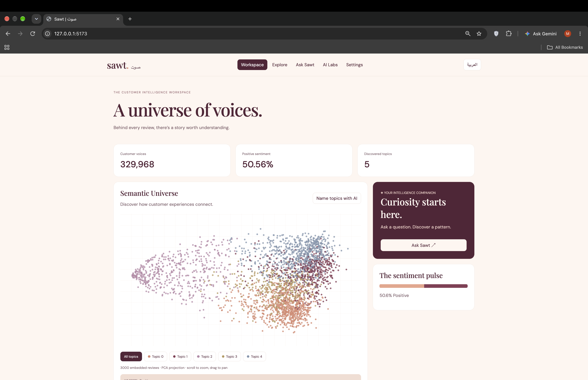
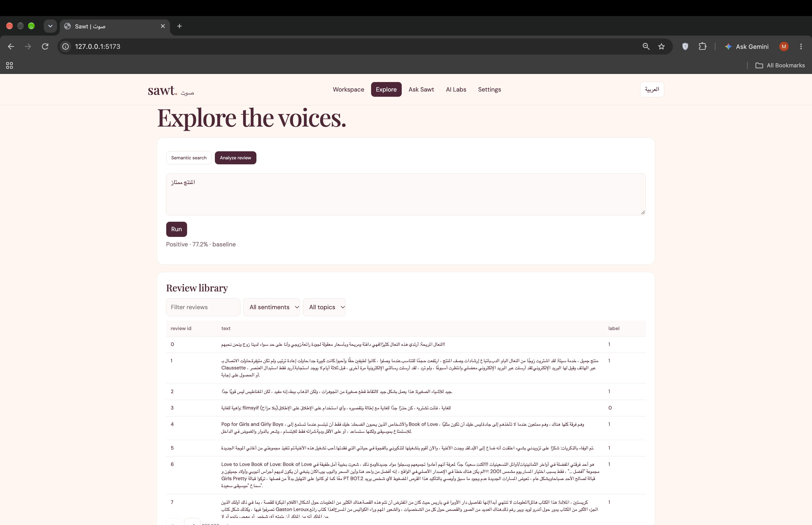
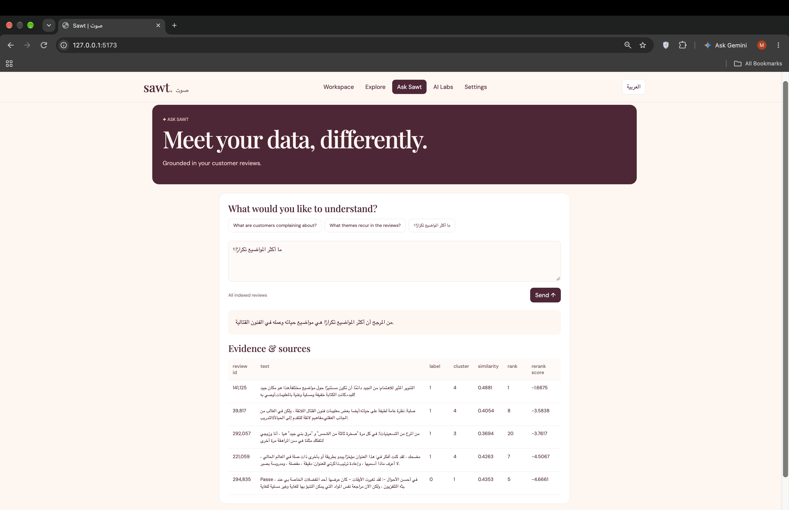
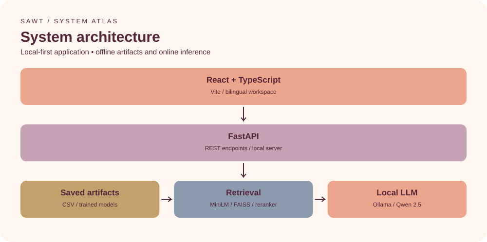
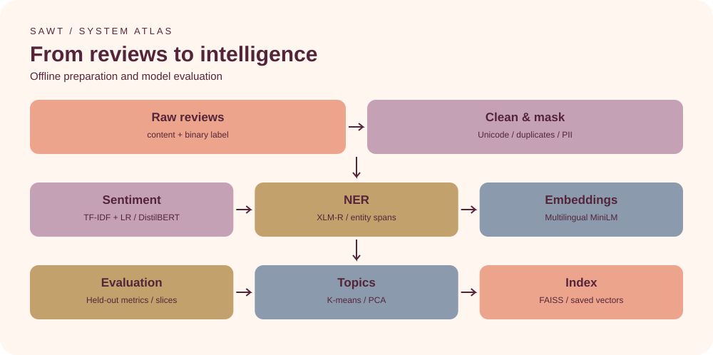

<div align="center">


# صوت | Sawt

**منصة ذكية ثنائية اللغة لتحليل وفهم آراء العملاء باستخدام تقنيات معالجة اللغة الطبيعية المقدمة من اكاديمية سدايا @SDAIAACADEMY .**


[نظرة عامة](#نظرة-عامة) · [معمارية النظام](#معمارية-النظام) · [معالجة اللغة الطبيعية](#معالجة-اللغة-الطبيعية) · [تشغيل المشروع](#تشغيل-المشروع-محليًا) · [القيود](#القيود)

</div>

---

## نظرة عامة
<div dir="rtl">

**صوت** هي منصة ذكية تهدف إلى تحويل مراجعات العملاء وآرائهم غير المنظمة إلى معلومات قابلة للبحث والتحليل والاستكشاف، بما يساعد على فهم تجارب العملاء واكتشاف الأنماط والموضوعات المتكررة في آرائهم.

تدعم المنصة اللغتين العربية والإنجليزية، وتجمع بين تقنيات تعلم الآلة، والتعلم العميق، ومعالجة اللغة الطبيعية، والبحث الدلالي، والذكاء الاصطناعي التوليدي.

تعتمد المنصة على التشغيل المحلي للنماذج، مما يقلل الحاجة إلى إرسال بيانات العملاء إلى خدمات الذكاء الاصطناعي الخارجية.


**صور النظام**
<br></br>
<div align="center">

</div>
<div align="center">

</div>
<div align="center">

</div>

### خصائص المنصة

| الخاصية | الوصف |
|---|---|
| عالم الأصوات — Semantic Universe | تمثيل بصري تفاعلي للمراجعات بناءً على التشابه الدلالي والموضوعات المكتشفة |
| الاستكشاف — Explore | تصفح المراجعات وتصفيتها والبحث الدلالي وتحليل المشاعر |
| اسأل صوت — Ask Sawt | طرح الأسئلة والحصول على إجابات مستندة إلى مراجعات فعلية |
| مختبرات الذكاء الاصطناعي — AI Labs | استعراض نتائج التجارب ومؤشرات تقييم النماذج |
| الإعدادات — Settings | التحقق من توفر النماذج والملفات وحالة النظام |

</div>

---

## معمارية النظام

<div align="center">

</div>

<div dir="rtl">

تعتمد معمارية صوت على فصل مرحلة معالجة البيانات وتدريب النماذج عن مرحلة تشغيل التطبيق والاستدلال.

تتولى دفاتر Jupyter معالجة البيانات وتدريب النماذج وتقييمها وتصدير المخرجات، بينما تتولى الواجهة الخلفية تحميل هذه المخرجات وتنفيذ عمليات الاستدلال والبحث.

تتيح الواجهة الأمامية للمستخدم استكشاف البيانات والتفاعل مع نتائج التحليل، ويُستخدم Ollama لتشغيل نموذج اللغة الكبير محليًا.

لا يتطلب تشغيل التطبيق إعادة تدريب النماذج عند توفر الملفات والمخرجات المحفوظة.

### التقنيات المستخدمة

| الطبقة | التقنيات |
|---|---|
| الواجهة الأمامية | React, TypeScript, Vite |
| التصور البصري | D3.js, Recharts |
| الواجهة الخلفية | Python, FastAPI |
| تعلم الآلة | Scikit-learn |
| التعلم العميق | PyTorch, Hugging Face Transformers |
| البحث الدلالي | Sentence Transformers, FAISS |
| الذكاء الاصطناعي التوليدي | Ollama |
| معالجة البيانات | Pandas, NumPy |
| التجارب وتقييم النماذج | Jupyter Notebook |

</div>

---

## معالجة اللغة الطبيعية

<div align="center">

</div>

<div dir="rtl">

### هيكلة دفاتر المشروع

يتكون المشروع من دفترين رئيسيين من نوع Jupyter Notebook، يغطيان مراحل العمل بدءًا من معالجة البيانات الخام، وصولًا إلى توليد إجابات مستندة إلى الأدلة.

### الدفتر الأول: معالجة البيانات وتطوير نماذج اللغة الطبيعية

**Preprocessing & NLP Pipeline**

يتولى هذا الدفتر تجهيز البيانات، وتطوير مكونات معالجة اللغة الطبيعية، وتقييم أداء النماذج، وحفظ المخرجات اللازمة لتشغيل التطبيق.

| المرحلة | الوصف |
|---|---|
| التحليل الاستكشافي للبيانات — EDA | دراسة خصائص البيانات وتوزيع المشاعر وأطوال المراجعات |
| تنظيف البيانات | إزالة السجلات غير الصالحة والمكررة والمتعارضة |
| تطبيع النصوص العربية | توحيد بعض أشكال الحروف العربية وإزالة التشكيل والتطويل وتنظيم المسافات |
| إخفاء المعلومات الشخصية — PII Masking | إخفاء الأنماط القابلة للتعرف مثل البريد الإلكتروني وأرقام الهواتف |
| تجزئة النصوص — Tokenization | تحليل آلية تجزئة النصوص العربية والإنجليزية |
| تحليل المشاعر — Sentiment Analysis | تدريب وتقييم نماذج تعلم الآلة والنماذج المعتمدة على المحولات |
| التعرف على الكيانات المسماة — NER | استخراج الكيانات مثل أسماء الأشخاص والمنظمات والمواقع |
| تحليل اللغة والنصوص | دراسة خصائص النصوص متعددة اللغات والمختلطة |
| التمثيل الدلالي — Embeddings | تحويل المراجعات إلى تمثيلات متجهية تعكس معانيها |
| اكتشاف الموضوعات — Clustering | تجميع المراجعات المتشابهة دلاليًا باستخدام K-means |
| تقليل الأبعاد — PCA | تمثيل المتجهات في فضاء ثنائي الأبعاد لأغراض التصور البصري |
| البحث الدلالي — Semantic Search | بناء فهرس FAISS لاسترجاع المراجعات ذات الصلة |
| إعادة ترتيب النتائج — Reranking | تحسين ترتيب نتائج البحث باستخدام نموذج Cross-Encoder |
| التقييم وتحليل الأخطاء | تقييم أداء النماذج ودراسة نقاط القوة والقيود |
| حفظ المخرجات | تصدير البيانات المعالجة والنماذج والمتجهات ونتائج التقييم |

### الدفتر الثاني: التوليد المعزز بالاسترجاع

**Retrieval-Augmented Generation — RAG**

يعتمد هذا الدفتر على المخرجات المحفوظة من الدفتر الأول، بهدف تطوير آلية للإجابة عن أسئلة المستخدم بالاستناد إلى مراجعات العملاء الفعلية.

| المرحلة | الوصف |
|---|---|
| تحميل المخرجات | تحميل البيانات المعالجة والمتجهات وفهرس FAISS |
| معالجة الاستعلام | تنظيف سؤال المستخدم وتحويله إلى تمثيل دلالي |
| استرجاع الأدلة | استرجاع المراجعات الأكثر ارتباطًا بالسؤال |
| إعادة ترتيب النتائج | تحسين ترتيب المراجعات المسترجعة وفقًا لمدى صلتها |
| بناء السياق | تجهيز الأدلة المسترجعة وإرسالها إلى نموذج اللغة |
| توليد الإجابة | استخدام نموذج لغة كبير يعمل محليًا عبر Ollama |
| إسناد الإجابات إلى الأدلة | ربط الإجابات بمعرفات المراجعات الداعمة |
| التقييم | دراسة مدى صلة الأدلة وجودة الإجابات وارتباطها بالمصادر |

تُستخدم هذه الدفاتر لأغراض التطوير والتجارب وإعادة إنتاج النتائج، ولا يلزم تشغيلها عند بدء استخدام التطبيق إذا كانت المخرجات المطلوبة متوفرة.

### النماذج والخوارزميات المستخدمة

| المهمة | النموذج أو الخوارزمية |
|---|---|
| النموذج الأساسي لتحليل المشاعر | Character TF-IDF + Logistic Regression |
| نموذج المحولات لتحليل المشاعر | `distilbert-base-multilingual-cased` — Fine-tuned |
| التعرف على الكيانات المسماة | `Davlan/xlm-roberta-base-ner-hrl` |
| التمثيل الدلالي للنصوص | `sentence-transformers/paraphrase-multilingual-MiniLM-L12-v2` |
| اكتشاف الموضوعات | K-means |
| تقليل الأبعاد والتصور البصري | PCA |
| البحث الدلالي | FAISS Inner Product Search |
| إعادة ترتيب نتائج البحث | `cross-encoder/mmarco-mMiniLMv2-L12-H384-v1` |
| توليد الإجابات | `qwen2.5:3b` عبر Ollama |

يستخدم التطبيق نموذج تحليل المشاعر المحدد في الملف `models/selected_model.json`.

تُعد أسماء الموضوعات المكتشفة أسماء وصفية للمجموعات الدلالية، وليست تصنيفات معتمدة مسبقًا.

تُعرض مؤشرات الأداء من ملفات نتائج التقييم المحفوظة، دون الاعتماد على قيم ثابتة داخل الواجهة.

</div>

---

## التوليد المعزز بالاسترجاع

<div align="center">

</div>

<div dir="rtl">

تستخدم منصة صوت تقنية التوليد المعزز بالاسترجاع (RAG) للإجابة عن أسئلة المستخدم بالاستناد إلى مراجعات العملاء الفعلية، بدلًا من الاعتماد الكامل على المعرفة الداخلية لنموذج اللغة.

تمر عملية الإجابة بالمراحل التالية:

1. استقبال سؤال المستخدم.
2. تنظيف السؤال ومعالجته.
3. تحويل السؤال إلى تمثيل متجهي باستخدام نموذج التمثيل الدلالي.
4. استرجاع المراجعات ذات الصلة باستخدام FAISS.
5. إعادة ترتيب النتائج باستخدام Cross-Encoder عند تفعيل هذه الخاصية.
6. اختيار ما يصل إلى خمس مراجعات ذات صلة.
7. بناء السياق وإرساله إلى نموذج اللغة المحلي.
8. توليد إجابة مستندة إلى الأدلة.
9. عرض معرفات المراجعات الداعمة للإجابة.

يُوجّه نموذج اللغة إلى الاعتماد على الأدلة المتاحة، والإشارة إلى عدم كفايتها عند الحاجة.

تُعامل النصوص المسترجعة على أنها بيانات غير موثوقة، وليست تعليمات يجب على نموذج اللغة تنفيذها.

</div>

---

## هيكلة المشروع

```text
Applied_NLP_SDAIA/
│
├── backend/
│   ├── main.py
│   └── requirements.txt
│
├── frontend/
│   ├── package.json
│   └── src/
│
├── notebooks/
│   ├── Preprocessing and NLP notebook
│   └── RAG notebook
│
├── data/
│   └── processed/
│       ├── masked.csv
│       ├── clusters.csv
│       ├── cluster_labels.csv
│       ├── embeddings.npy
│       ├── feedback.faiss
│       ├── entities.csv
│       └── sentiment_metrics.csv
│
├── models/
│   ├── sentiment.joblib
│   ├── distilbert/
│   └── selected_model.json
│
├── docs/
│   ├── banner.svg
│   ├── architecture.svg
│   ├── nlp.svg
│   └── rag.svg
│
├── setup.sh
├── start.sh
├── .gitignore
└── README.md
```

<div dir="rtl">

### وصف المجلدات

| المجلد | المحتوى |
|---|---|
| `backend/` | الواجهة الخلفية وخدمات الاستدلال والبحث |
| `frontend/` | الواجهة الأمامية ومكونات التصور البصري |
| `notebooks/` | دفاتر معالجة البيانات وتطوير النماذج وRAG |
| `data/processed/` | البيانات المعالجة والمتجهات والفهارس ونتائج التقييم |
| `models/` | النماذج المدربة وإعدادات اختيار النموذج |
| `docs/` | الرسومات التوضيحية والهوية البصرية للمشروع |

أسماء الدفاتر الموضحة في الهيكلة وصفية. قد يحتوي المشروع أيضًا على ملفات إضافية لنتائج التقييم وربط المتجهات بالمراجعات.

يجب الاحتفاظ بالمتجهات والفهارس والبيانات المرتبطة بها من نفس عملية المعالجة.

</div>

---

## تشغيل المشروع محليًا

<div dir="rtl">

توضح الخطوات التالية كيفية تحميل منصة صوت من GitHub وتجهيزها وتشغيلها على جهازك الشخصي.

لا يتطلب تشغيل المنصة إعادة تدريب النماذج أو تشغيل دفاتر Jupyter عند توفر المخرجات والنماذج المحفوظة.

### 1. متطلبات التشغيل

يجب تثبيت الأدوات التالية قبل البدء:

| الأداة | الإصدار الموصى به | رابط التحميل |
|---|---|---|
| Python | 3.12 | [تحميل Python](https://www.python.org/downloads/) |
| Node.js | 22 | [تحميل Node.js](https://nodejs.org/) |
| Git | أحدث إصدار مستقر | [تحميل Git](https://git-scm.com/downloads) |
| Ollama | أحدث إصدار مستقر | [تحميل Ollama](https://ollama.com/download) |

**مواصفات الجهاز الموصى بها:**

- نظام تشغيل macOS أو Linux.
- ذاكرة عشوائية بسعة 16 GB أو أكثر.
- مساحة تخزين كافية للنماذج والبيانات المعالجة.
- اتصال بالإنترنت أثناء التثبيت الأولي.

لا يشترط توفر بطاقة رسومية مستقلة، إلا أن سرعة الاستدلال تعتمد على إمكانيات الجهاز وحجم النماذج المستخدمة.

### 2. تحميل المشروع

يمكن تحميل المشروع باستخدام Git عبر تنفيذ الأوامر التالية:

</div>

```bash
git clone https://github.com/romey101/Applied_NLP_SDAIA.git
cd Applied_NLP_SDAIA
```

<div dir="rtl">

أو تحميل المشروع مباشرة بصيغة ZIP:

[تحميل مشروع صوت](https://github.com/romey101/Applied_NLP_SDAIA/archive/refs/heads/main.zip)

بعد التحميل، فك ضغط الملف وافتح Terminal داخل مجلد المشروع.

### 3. تجهيز البيانات والنماذج

تعتمد المنصة على مخرجات معالجة البيانات والنماذج المدربة مسبقًا لتجنب إعادة تنفيذ عمليات التدريب والمعالجة عند التشغيل.

يجب توفر المجلدين التاليين بكامل محتوياتهما المطلوبة:

</div>

```text
data/processed/
models/
```

<div dir="rtl">

إذا كانت الملفات متوفرة ضمن النسخة المحملة، يمكنك الانتقال إلى الخطوة التالية.

في حال عدم توفرها، تحقق من صفحة إصدارات المشروع:

[GitHub Releases](https://github.com/romey101/Applied_NLP_SDAIA/releases)

إذا كانت حزمة المخرجات والنماذج متوفرة، حمّلها وفك ضغطها داخل المجلد الرئيسي للمشروع.

في حال عدم توفر الحزمة، تواصل مع مطور المشروع للحصول على الملفات اللازمة بطريقة معتمدة وآمنة.

> تحميل الكود المصدري وحده لا يكفي لتشغيل جميع خصائص المنصة دون توفر البيانات المعالجة والنماذج المطلوبة.

يجب عدم خلط المخرجات الناتجة عن عمليات معالجة مختلفة، كما يجب تحميل ملفات النماذج المحفوظة من مصادر موثوقة فقط.

### 4. تشغيل Ollama

افتح نافذة Terminal جديدة ونفّذ الأمر التالي:

</div>

```bash
ollama serve
```

<div dir="rtl">

إذا كانت خدمة Ollama تعمل مسبقًا، يمكنك تجاوز هذه الخطوة.

افتح نافذة Terminal أخرى وحمّل نموذج اللغة الافتراضي:

</div>

```bash
ollama pull qwen2.5:3b
```

<div dir="rtl">

للتحقق من توفر النموذج:

</div>

```bash
ollama list
```

<div dir="rtl">

### 5. تثبيت مكتبات المشروع

من داخل المجلد الرئيسي للمشروع، نفّذ:

</div>

```bash
bash setup.sh
```

<div dir="rtl">

يتولى هذا الملف تجهيز البيئة الافتراضية الخاصة بـ Python وتثبيت مكتبات الواجهة الخلفية والأمامية.

تُنفذ هذه الخطوة عند التثبيت الأول فقط، أو عند تحديث مكتبات المشروع.

### 6. تشغيل المنصة

من داخل المجلد الرئيسي للمشروع، نفّذ:

</div>

```bash
bash start.sh
```

<div dir="rtl">

بعد بدء تشغيل الخدمات، افتح المنصة من خلال المتصفح.

| الخدمة | الرابط |
|---|---|
| منصة صوت | [فتح المنصة](http://127.0.0.1:5173) |
| الواجهة الخلفية | [Backend API](http://127.0.0.1:8000) |
| توثيق واجهات API | [Swagger Documentation](http://127.0.0.1:8000/docs) |
| حالة النظام | [System Health](http://127.0.0.1:8000/api/health) |

قد تتطلب أول عملية بحث دلالي تحميل النماذج المدربة مسبقًا من Hugging Face.

لتشغيل المنصة دون اتصال بالإنترنت، يجب تحميل النماذج المطلوبة وتخزينها محليًا مسبقًا.

</div>

---

## التشغيل اليدوي

<div dir="rtl">

في حال عدم توفر ملفات التشغيل التلقائي أو حدوث مشكلة أثناء استخدامها، يمكن تشغيل مكونات المنصة يدويًا باستخدام ثلاث نوافذ Terminal منفصلة.

### النافذة الأولى: تشغيل Ollama

</div>

```bash
ollama serve
```

<div dir="rtl">

يمكن تجاوز هذه الخطوة إذا كانت الخدمة تعمل مسبقًا.

### النافذة الثانية: تشغيل الواجهة الخلفية

انتقل إلى المجلد الرئيسي للمشروع، ثم أنشئ البيئة الافتراضية وفعّلها:

</div>

```bash
python3.12 -m venv .venv
source .venv/bin/activate
```

<div dir="rtl">

ثبّت مكتبات الواجهة الخلفية:

</div>

```bash
python -m pip install --upgrade pip
python -m pip install -r backend/requirements.txt
```

<div dir="rtl">

اضبط متغيرات البيئة:

</div>

```bash
export SAWT_ROOT="$(pwd)"
export PYTHONFAULTHANDLER=1
export OMP_NUM_THREADS=1
export MKL_NUM_THREADS=1
export OPENBLAS_NUM_THREADS=1
export VECLIB_MAXIMUM_THREADS=1
export TOKENIZERS_PARALLELISM=false
```

<div dir="rtl">

تُستخدم هذه الإعدادات لتقليل التزامن داخل المكتبات وتحسين استقرار عمليات الاستدلال، خصوصًا على أجهزة Apple Silicon.

شغّل خادم FastAPI:

</div>

```bash
cd backend

python -X faulthandler -m uvicorn main:app \
    --host 127.0.0.1 \
    --port 8000 \
    --workers 1 \
    --log-level debug
```

<div dir="rtl">

### النافذة الثالثة: تشغيل الواجهة الأمامية

انتقل إلى المجلد الرئيسي للمشروع، ثم نفّذ:

</div>

```bash
cd frontend
npm install
npm run dev
```

<div dir="rtl">

افتح المنصة عبر الرابط التالي:

[http://127.0.0.1:5173](http://127.0.0.1:5173)

</div>

---

## تغيير نموذج اللغة

<div dir="rtl">

تدعم منصة صوت تشغيل نماذج اللغة الكبيرة محليًا باستخدام Ollama.

يمكن تجربة نماذج مختلفة لتقييم جودة الإجابات وسرعة الاستدلال.

| النموذج | معرف النموذج في Ollama |
|---|---|
| Qwen 2.5 | `qwen2.5:3b` |
| Llama 3.1 | `llama3.1:8b` |
| Gemma 3 | `gemma3:4b` |
| Aya Expanse | `aya-expanse:8b` |

النموذج الافتراضي هو Qwen 2.5 3B.

### استخدام نموذج Llama

</div>

```bash
ollama pull llama3.1:8b
SAWT_LLM=llama3.1:8b bash start.sh
```

<div dir="rtl">

### استخدام نموذج Gemma

</div>

```bash
ollama pull gemma3:4b
SAWT_LLM=gemma3:4b bash start.sh
```

<div dir="rtl">

تتطلب هذه الأوامر استخدام إصدار الواجهة الخلفية الذي يدعم متغير البيئة `SAWT_LLM`.

قد تتطلب النماذج البديلة موارد إضافية، ولم تُقيّم جميعها بصورة كاملة على بيانات صوت. كما قد تختلف جودة توليد النصوص العربية من نموذج إلى آخر.

لا يتطلب تغيير نموذج اللغة إعادة تدريب نموذج تحليل المشاعر، أو إعادة توليد المتجهات، أو إعادة بناء فهرس FAISS.

تبقى أسماء الموضوعات المحفوظة دون تغيير إلى أن يُعاد توليدها.

</div>

---

## التحقق من سلامة التشغيل

<div dir="rtl">

بعد تشغيل الواجهة الخلفية، يمكن استخدام الأوامر التالية للتحقق من عمل الخدمات الرئيسية.

### التحقق من حالة النظام

</div>

```bash
curl http://127.0.0.1:8000/api/health
```

<div dir="rtl">

### التحقق من استرجاع المراجعات

</div>

```bash
curl "http://127.0.0.1:8000/api/reviews?q=&offset=0&limit=15"
```

<div dir="rtl">

### اختبار البحث الدلالي

</div>

```bash
curl -X POST http://127.0.0.1:8000/api/search \
    -H "Content-Type: application/json" \
    -d '{"text":"جودة المنتج","rerank":true}'
```

<div dir="rtl">

### اختبار التوليد المعزز بالاسترجاع

</div>

```bash
curl -X POST http://127.0.0.1:8000/api/chat \
    -H "Content-Type: application/json" \
    -d '{"text":"ما هي أبرز شكاوى العملاء؟","rerank":true}'
```

<div dir="rtl">

تؤكد الاستجابة الناجحة لخدمة حالة النظام توفر الملفات المطلوبة، بينما تساعد اختبارات البحث والمحادثة على التحقق من عمل خدمات الاستدلال.

</div>

---

## معالجة المشكلات الشائعة

<div dir="rtl">

| المشكلة | الحل المقترح |
|---|---|
| Missing Artifact | التحقق من توفر الملفات المطلوبة داخل `data/processed/` و`models/` |
| تعذر الاتصال بـ Ollama | التأكد من تشغيل الخدمة على المنفذ 11434 |
| عدم توفر نموذج اللغة | تحميل النموذج باستخدام `ollama pull` |
| تعارض مكتبات Python | استخدام Python 3.12 والإصدارات المحددة في ملف المتطلبات |
| Segmentation Fault | تطبيق إعدادات تحديد عدد Threads، وعدم خلط Conda مع البيئة الافتراضية، وفحص إمكانية استخدام CPU فقط |
| مشكلة في الواجهة الأمامية | تنفيذ `npm install` داخل مجلد `frontend/` |
| تعذر الاتصال بالواجهة الخلفية | التأكد من تشغيل FastAPI على المنفذ 8000 |
| بطء أول عملية استدلال | الانتظار حتى اكتمال تحميل النماذج وتهيئتها |
| المنفذ مستخدم مسبقًا | إيقاف الخدمة الأخرى التي تستخدم المنفذ نفسه |

قد تتطلب بعض أخطاء المكتبات الأصلية معالجة إضافية بحسب نظام التشغيل والجهاز المستخدم. إعدادات تحديد عدد Threads إجراء لتقليل احتمالية حدوث المشكلة، وليست حلًا مضمونًا لجميع الحالات.

### إيقاف المنصة وإعادة تشغيلها

لإيقاف الخدمات، اضغط `Ctrl+C` داخل نوافذ Terminal التي تعمل فيها الخدمات.

لإعادة تشغيل المنصة لاحقًا، تأكد من تشغيل Ollama ثم نفّذ:

</div>

```bash
bash start.sh
```

<div dir="rtl">

لا يلزم إعادة تثبيت المكتبات أو تشغيل دفاتر Jupyter أو إعادة تدريب النماذج عند كل عملية تشغيل.

</div>

---

## واجهات برمجة التطبيقات

<div dir="rtl">

توفر الواجهة الخلفية مجموعة من واجهات API لدعم خصائص المنصة.

| الطريقة | المسار | الوصف |
|---|---|---|
| GET | `/api/health` | التحقق من توفر الملفات والنماذج |
| GET | `/api/overview` | عرض الإحصائيات العامة للبيانات |
| GET | `/api/universe` | عرض نقاط التمثيل البصري والموضوعات الدلالية |
| GET | `/api/reviews` | استرجاع المراجعات والبحث فيها |
| GET | `/api/entities` | عرض ملخصات الكيانات المسماة |
| GET | `/api/metrics` | استرجاع نتائج تقييم النماذج |
| POST | `/api/analyze` | تحليل المشاعر للنصوص المدخلة |
| POST | `/api/search` | البحث الدلالي |
| POST | `/api/chat` | توليد إجابات مستندة إلى الأدلة |
| POST | `/api/topic-names` | توليد أسماء وصفية للموضوعات |

يمكن استعراض واجهات API وتجربتها من خلال التوثيق التفاعلي:

[Swagger API Documentation](http://127.0.0.1:8000/docs)

</div>

---

## القيود

<div dir="rtl">

على الرغم من إمكانيات المنصة، توجد مجموعة من القيود التي يجب أخذها بعين الاعتبار عند تفسير النتائج:

- يعتمد تحليل المشاعر على التصنيف الثنائي، ولا يتضمن تصنيفًا مستقلًا للمشاعر المحايدة أو المختلطة.
- الموضوعات المكتشفة باستخدام التجميع الدلالي استكشافية، وليست تصنيفات معتمدة أو محددة مسبقًا.
- يؤدي تقليل الأبعاد باستخدام PCA إلى فقدان جزء من المعلومات الموجودة في التمثيلات الأصلية.
- قد تُطبق بعض عمليات البحث والتعرف على الكيانات على عينات من البيانات بدلًا من كامل مجموعة البيانات.
- لا تمثل درجات الثقة في التعرف على الكيانات المسماة قياسًا مباشرًا لدقة النموذج.
- لا تضمن عملية إخفاء المعلومات الشخصية باستخدام التعبيرات النمطية إزالة جميع المعلومات الحساسة.
- قد ينتج نموذج اللغة إجابات غير مكتملة أو غير دقيقة.
- لا ينبغي تعميم النتائج المستندة إلى عدد محدود من المراجعات المسترجعة على كامل مجموعة البيانات.
- تعتمد سرعة الاستدلال المحلي على إمكانيات الجهاز وحجم النموذج المستخدم.
- إعدادات التشغيل الحالية مخصصة للتطوير والتجارب المحلية، وليست بيئة إنتاج مؤمنة بالكامل.
- يجب التحقق من حقوق استخدام البيانات والنماذج ومتطلبات الخصوصية قبل إعادة توزيعها.

</div>

---

## المراجع

<div dir="rtl">

### معالجة اللغة الطبيعية وتعلم الآلة

- [Hugging Face Transformers](https://huggingface.co/docs/transformers/)
- [Sentence Transformers](https://www.sbert.net/)
- [Scikit-learn](https://scikit-learn.org/)
- [PyTorch](https://pytorch.org/)
- [FAISS](https://github.com/facebookresearch/faiss)

### النماذج المدربة مسبقًا

- [Multilingual DistilBERT](https://huggingface.co/distilbert/distilbert-base-multilingual-cased)
- [Multilingual XLM-R NER](https://huggingface.co/Davlan/xlm-roberta-base-ner-hrl)
- [Multilingual MiniLM Embeddings](https://huggingface.co/sentence-transformers/paraphrase-multilingual-MiniLM-L12-v2)
- [Multilingual Cross-Encoder](https://huggingface.co/cross-encoder/mmarco-mMiniLMv2-L12-H384-v1)
- [Qwen 2.5](https://ollama.com/library/qwen2.5)

### تطوير التطبيقات

- [FastAPI](https://fastapi.tiangolo.com/)
- [React](https://react.dev/)
- [TypeScript](https://www.typescriptlang.org/)
- [Vite](https://vite.dev/)
- [D3.js](https://d3js.org/)
- [Recharts](https://recharts.org/)
- [Ollama](https://docs.ollama.com/)

</div>

---

<div align="center">


**صوت · لكل صوت حكاية**

A universe of voices.

</div>
